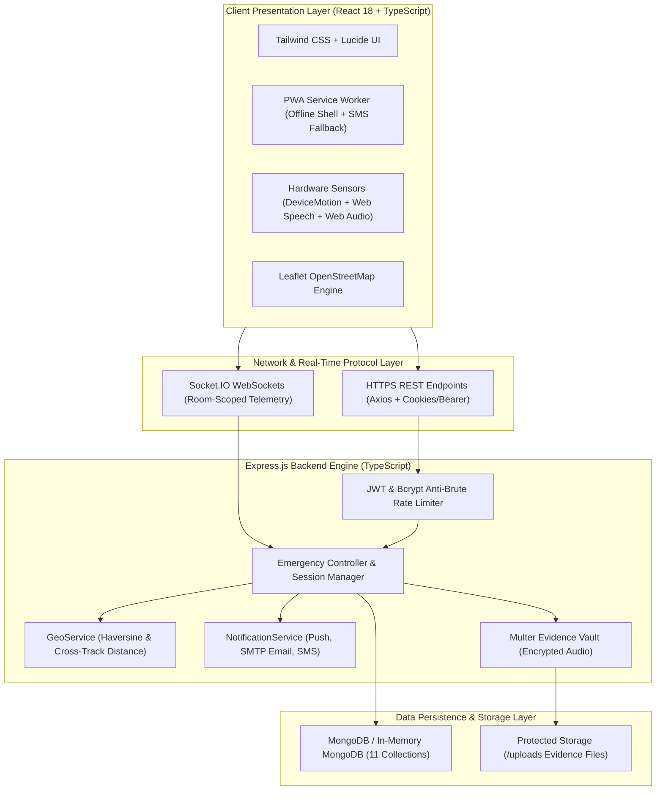
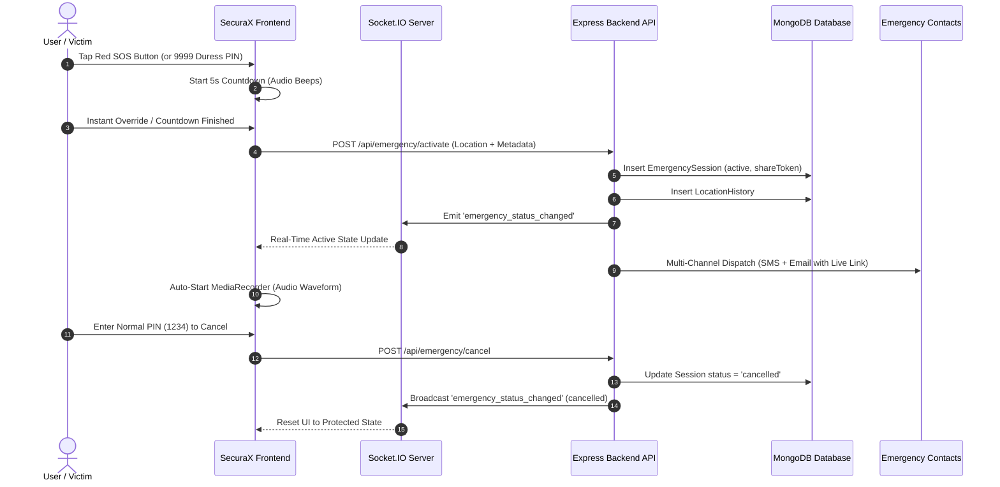
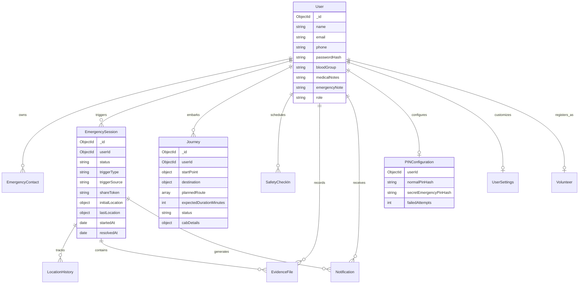

# 🎓 SecuraX – Major Project Defense & Viva Voce Guide
> **Platform Name:** SecuraX – Smart Personal Safety & Emergency Response Platform  
> **Tagline:** *Your Safety. Your Control. Always.*  
> **Target Audience:** College External Examiners, Technical Interviewers, Project Evaluators

---

## 1. Project Abstract & Problem Statement

### 1.1 The Problem
In distress situations (such as nighttime commuting, isolated travel, route diversion by cab drivers, or physical harassment), victims often experience:
1. **Physical or cognitive freezing:** Complex phone unlocking or app navigation is impossible under adrenaline-induced stress.
2. **Coercion & forced compliance:** Assailants frequently force victims to unlock devices, rendering standard SOS apps detectable and dangerous.
3. **Passive GPS delays:** Conventional tracking requires constant network availability and lacks immediate cross-track corridor boundary validation.
4. **Lack of verifiable ambient evidence:** Post-incident investigations often collapse due to absence of tamper-evident audio or timestamped location logs.

### 1.2 The SecuraX Solution
**SecuraX** is an end-to-end, full-stack safety tech ecosystem that unites:
- **Zero-Friction Activation:** One-Tap Red SOS, Dead-Man switch timers, DeviceMotion shake sensing, and hands-free Web Speech recognition.
- **Anti-Coercion Stealth Camouflage:** A dual PIN architecture with a fully functional Calculator Disguise (`1234` normal unlock vs `9999` silent duress trigger).
- **Proactive Cab Monitoring:** Mathematical route corridor deviation detection using the Cross-Track Haversine algorithm.
- **Resilient Multi-Channel Dispatch:** WebSockets (Socket.IO) for sub-second telemetry, alongside automated Web Push, SMTP Email, and offline SMS dialer fallbacks.

---

## 2. High-Level System Architecture

---

## 3. Emergency SOS Sequence Diagram

---

## 4. Database Entity-Relationship (ER) Schema

---

## 5. Mathematical & Algorithmic Foundation: Route Deviation Detection

### 5.1 Haversine Distance Formula
To compute great-circle distance $d$ between two points on the Earth's surface given latitude and longitude coordinates $(\phi_1, \lambda_1)$ and $(\phi_2, \lambda_2)$:

$$\Delta\phi = \phi_2 - \phi_1, \quad \Delta\lambda = \lambda_2 - \lambda_1$$

$$a = \sin^2\left(\frac{\Delta\phi}{2}\right) + \cos(\phi_1)\cos(\phi_2)\sin^2\left(\frac{\Delta\lambda}{2}\right)$$

$$c = 2 \cdot \text{atan2}\left(\sqrt{a}, \sqrt{1-a}\right)$$

$$d = R \cdot c$$

Where $R = 6,371,000 \text{ meters}$ (mean radius of Earth).

### 5.2 Cross-Track Corridor Projection (Point to Segment)
Given a planned polyline path consisting of consecutive nodes $A(\text{lat}_A, \text{lng}_A)$ and $B(\text{lat}_B, \text{lng}_B)$, and the vehicle's current location $P(\text{lat}_P, \text{lng}_P)$:

1. Parameter $t$ projects $P$ onto segment $AB$:
   $$t = \frac{(P - A) \cdot (B - A)}{\|B - A\|^2}$$
2. Clamping $t \in [0, 1]$ finds the nearest point $P_{\text{proj}}$ on the finite corridor line segment:
   $$t_{\text{clamped}} = \max(0, \min(1, t))$$
   $$P_{\text{proj}} = A + t_{\text{clamped}} \cdot (B - A)$$
3. The cross-track offset distance $\delta$ is:
   $$\delta = \text{Haversine}(P, P_{\text{proj}})$$
4. If $\min(\delta) > \text{threshold}$ (e.g. 300 meters), a **Route Deviation Alert** triggers automatically!

---

## 6. Examiner Viva Voce: 20 Likely Questions & Model Answers

### Category A: Architecture & Full-Stack Fundamentals

#### Q1: Why did you choose React with TypeScript over plain JavaScript?
> **Answer:** Personal safety and emergency dispatch systems deal with critical, time-sensitive payloads (coordinates, accuracy meters, timestamps, session tokens). TypeScript enforces static compile-time contracts across frontend components, API service payloads, and socket events, eliminating runtime `TypeError: undefined is not a function` risks during live distress scenarios.

#### Q2: How does the application maintain real-time responsiveness during an emergency?
> **Answer:** SecuraX uses **Socket.IO** atop WebSockets for bidirectional, low-latency communication. Sessions are partitioned into rooms:
> - `user:{userId}` for private alerts across devices.
> - `emergency:{sessionId}` for active incident dispatchers.
> - `tracking:{shareToken}` for public non-authenticated contact viewing.  
> When the device transmits new GPS coordinates, they are broadcasted to listening rooms in sub-100ms without polling.

#### Q3: Why is MongoDB suited for this platform?
> **Answer:** Safety data structures vary widely: a journey contains planned arrays of polyline coordinates and safety check subdocuments; an emergency session contains dynamic location points and cancel reason logs; evidence files contain metadata. MongoDB's document model with Mongoose schemas handles nested geospatial structures without complex multi-table SQL joins.

---

### Category B: Security, Anti-Coercion & Anti-Brute-Force

#### Q4: What is the Fake PIN / Duress PIN feature, and how does it prevent assailant retaliation?
> **Answer:** In hostage, stalking, or coercion situations, assailants frequently force victims to unlock their phone. SecuraX implements two distinct Bcrypt hashes:
> - **Normal PIN (`1234`):** Safely exits or cancels an emergency.
> - **Secret Emergency PIN (`9999`):** When entered on the login, disguise calculator, or cancel dialog, it **secretly triggers the emergency engine**, uploads coordinates, and dispatches SMS/Email alerts. Crucially, the UI displays a normal "Access Granted" or standard calculator result without any emergency indicators, keeping the assailant unaware.

#### Q5: How do you protect authentication and API endpoints from brute-forcing?
> **Answer:** We employ multi-tiered protection:
> 1. `express-rate-limit` limits authentication routes to 30 requests / 15 minutes, and PIN verification to 10 requests / 5 minutes.
> 2. Bcrypt with salt rounds (10) for password and PIN hashing.
> 3. HTTP-only secure cookies prevents cross-site scripting (XSS) token theft, complemented by Bearer Authorization headers for flexibility.
> 4. Helmet security headers configure strict CSP, X-Frame-Options, and XSS filtering.

---

### Category C: Hardware Sensors & Web APIs

#### Q6: How does emergency audio recording work, and does it breach user privacy?
> **Answer:** We use the HTML5 `MediaRecorder` API coupled with Web Audio API `AnalyserNode` to draw a real-time visual waveform. SecuraX adheres strictly to web security standards:
> - Microphone access is only requested with explicit user interaction.
> - A live indicator displays recording duration and waveform activity.
> - Browser security policies require an open tab for audio recording, which we clearly explain to users.
> - Uploaded audio (`.webm`) is saved to protected disk storage and referenced in MongoDB.

#### Q7: How does "Shake to Activate SOS" operate in a web environment?
> **Answer:** It listens to the window's `devicemotion` event, computing the acceleration vector $\sqrt{x^2 + y^2 + z^2}$. When acceleration exceeds the configured sensitivity threshold repeatedly within a time window, the emergency countdown is armed. A cooldown period prevents accidental false triggers.

#### Q8: How does Voice-Activated SOS work?
> **Answer:** It leverages the Web Speech Recognition API (`webkitSpeechRecognition`). When active, it processes speech-to-text transcripts locally in the browser and checks for the user's defined trigger keyword (e.g. `"help securax"`). Once recognized, it initiates the 5-second emergency countdown.

---

### Category D: PWA Offline Resilience & Geofencing

#### Q9: What happens if an emergency occurs when there is NO internet connectivity?
> **Answer:** SecuraX implements a Service Worker (`sw.js`) that caches the application shell. When offline:
> 1. An ambient amber/red **Offline Emergency Banner** appears.
> 2. Direct device dialer links (`tel:112`, `tel:102`) open the native phone dialer with zero internet requirement.
> 3. A prefilled SMS fallback (`sms:?body=...`) encodes the victim's last known GPS coordinates into the native SMS messaging client, ready to send with one tap.

#### Q10: How does the public tracking link work without requiring contacts to sign up?
> **Answer:** Each emergency session creates a cryptographically random, unguessable 32-character hexadecimal token (`shareToken = crypto.randomBytes(16).toString('hex')`). The endpoint `GET /api/emergency/track/:shareToken` is publicly readable, serving the victim's live coordinates, medical information (blood group, allergies), and quick dial buttons directly to emergency contacts who receive the link via SMS or Email.

---

## 7. Step-by-Step Live Demonstration Script for Examiners

| Step | Action | What to Explain to the Examiner |
| :---: | :--- | :--- |
| **1** | Open [http://localhost:5173](http://localhost:5173) | Point out the trusted safety design system, emergency hotline ticker (112, 102), and feature grid. |
| **2** | Click **"One-Click Demo Login"** on [/login](http://localhost:5173/login) | Explain JWT authentication, Bcrypt password verification, and pre-seeded demonstration data. |
| **3** | On the Dashboard, press the **Central Red SOS Button** | Observe the 5-second countdown with synthesized Web Audio beeps and instant dispatch button. |
| **4** | Navigate to [/emergency](http://localhost:5173/emergency) | Show the active Leaflet GPS beacon, audio evidence waveform recorder, and public shareable link. |
| **5** | Click **"Copy Link"** and open [/track/:shareToken](http://localhost:5173/emergency) in an Incognito Tab | Demonstrate that family members can track real-time position without needing an account. |
| **6** | Click the **Calculator Icon** in the Navbar | Show the functional calculator disguise. Type `9999 =` to demonstrate the secret duress trigger. |
| **7** | Navigate to [/route-monitoring](http://localhost:5173/route-monitoring) | Click **"Simulate Off-Route Detour"** to show the Cross-Track Haversine deviation engine detecting a 750m detour. |
| **8** | Navigate to [/safety-timer](http://localhost:5173/safety-timer) | Click **"Demo 10s Fast Test"** to show dead-man switch expiry and automatic SOS escalation. |
| **9** | Navigate to [/evidence](http://localhost:5173/evidence) | Show the stored emergency audio evidence recordings with built-in playback and download capabilities. |
| **10** | Click **"Resolve & Cancel SOS"** on the Dashboard | Enter Normal PIN `1234` to verify genuine safety confirmation. Show safe resolution state. |

---

## 8. Placement Resume & Portfolio Talking Points

### Resume Bullet Points:
- *Architected and developed **SecuraX**, a full-stack personal safety and emergency response platform utilizing React 18, TypeScript, Node.js, Express, Socket.IO, and MongoDB.*
- *Implemented mathematical cross-track **Haversine geo-fencing** algorithms to detect real-time cab route deviations (>300m) with sub-second alert triggers.*
- *Designed an **anti-coercion dual-PIN stealth architecture** with Bcrypt hashing and a functional calculator camouflage view to protect victims under duress.*
- *Engineered an in-browser ambient **emergency audio evidence recorder** using HTML5 MediaRecorder and Web Audio API with secure encrypted backend storage.*
- *Constructed **PWA offline emergency fallbacks** incorporating service worker caching, direct device dialer hooks (`tel:112`), and encoded SMS triggers.*
